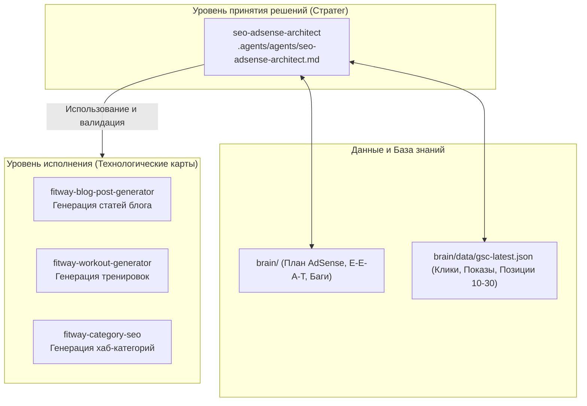

# AI Agents & Content Skills Architecture: E-E-A-T, Strapi 5 & Hub & Spoke Matrix

Документация по архитектуре специализированных AI-агентов и модульных навыков (Skills) проекта FitWay, правилам валидации E-E-A-T (авторы и медицинские рецензенты), защите от маркеров машинной генерации и матрице внутренней перелинковки.

---

## 🎯 Архитектурная модель: «Стратег» и «Навыки»

В проекте FitWay реализовано строгое разделение ответственности между ролью AI-агента и исполняемыми навыками:

1. **Агент (`seo-adsense-architect`)**: Главный SEO-стратег и технический веб-архитектор. Владеет общей картиной, контролирует дорожную карту AdSense [[roadmap/adsense-approval-plan]], управляет CLI-клиентом [[frontend/gsc-api-integration]], блокирует преждевременную подачу заявки (правило **Traffic Gatekeeper**) и рецензирует контент.
2. **Навыки (`.agents/skills/`)**: Автономные спецификации, содержащие схемы Strapi, анти-AI правила, списки первоисточников и валидаторы.

---

## 🤖 1. Агент: `seo-adsense-architect`
- **Файл**: `.agents/agents/seo-adsense-architect.md`
- **Ключевой функционал**:
  - **Traffic Gatekeeper**: Контроль порога 15–30+ кликов в день перед подачей заявки в AdSense.
  - **GSC CLI Runner**: Вызов команды `python scripts/gsc_client.py` и инспекция URL.
  - **RPM Optimization**: Проектирование рекламных слотов с `min-h-[250px]` для защиты Core Web Vitals (CLS < 0.1).
  - **Next.js & Strapi Standards**: Соблюдение Service Layer pattern, чистоты каноникалов и разметки Schema.org.

---

## 🛠️ 2. Модернизированный пул навыков FitWay

### 1. `fitway-blog-post-generator`
- **Назначение**: Создание глубоких (1200–1800 слов) статей в формате JSON для Strapi (`api::post.post`).
- **Ключевые регламенты**:
  - **Обязательная связь `reviewedBy`**: В соответствии со стандартами YMYL и дорожной картой AdSense каждая статья имеет автора и **парного медицинского/научного рецензента**:
    - Питание/добавки: автор Mike Chen (ID: 5) $\rightarrow$ рецензент Sarah Johnson (`[{ "id": 3 }]`, RD/диетолог).
    - Тренировки: автор Mike Chen (ID: 5) $\rightarrow$ рецензент Richard Botich (`[{ "id": 1 }]`, NASM-CPT).
  - **Мастер-реестр перелинковки (`references/internal-links.md`)**: Обязательное внедрение 1–2 ссылок на калькуляторы [[frontend/fitness-calculators-pseo]] и 1–2 ссылок на воркауты.
  - **Интеграция с GSC**: Шаг 1.6 сверяет тему с `brain/data/gsc-latest.json` и встраивает фразы из Low-Hanging Fruits (позиции 10–30) в H2 и FAQ.
  - **Верификация PubMed**: Минимум 3 прямые ссылки с валидацией реальных PMID через веб-поиск.

### 2. `fitway-workout-generator`
- **Назначение**: Создание программ тренировок для коллекции Strapi `workout` и компонентов `fitness.exercise`, `fitness.nutrition-tips`.
- **Ключевые регламенты**:
  - **Устранение анонимности**: Обязательные relations `"author": { "id": 1 }` (Richard Botich) и `"reviewedBy": [{ "id": 5 }]` (Mike Chen).
  - **Реестр существующих воркаутов (`references/existing-workouts.md`)**: Защита от дублирования 11 опубликованных программ.
  - **Перелинковка в поле `text` (300–800 слов)**: Обязательные ссылки на калькулятор 1RM (`/tools/one-rep-max-calculator`) для силовых или калькулятор калорий (`/tools/calorie-calculator`) для кардио.

### 3. `fitway-category-seo`
- **Назначение**: Написание текстовых полей Strapi `category` (`title`, `intro`, `text`, `metaTitle`, `metaDescription`) для превращения страниц `/blog/category/{slug}` в хабы.
- **Инфраструктура (`references/`)**:
  - `category-map.md`: Полный маппинг 6 категорий (Nutrition, Muscle Building, Weight Loss, Training, Lifestyle, Motivation) с ключами, интентом и связками.
  - `style-rules.md`: Запрет клише AI (*delve into*, *game-changer*, *tapestry*), правила медицинской безопасности.
  - `output-schema.md`: Правило предотвращения дублирования бренда в `metaTitle` (Next.js добавляет `| FitWay` автоматически).
  - **Категорический запрет Em Dash (`—`)**: Исключение длинного тире во всех полях для защиты от алгоритмических AI-детекторов Google.

---

## 🔗 Связанные документы
- [[frontend/gsc-api-integration]] — API-клиент Search Console и URL Inspection инструмент.
- [[frontend/gsc-crawled-not-indexed-resolution]] — Стратегия ликвидации статуса «Просканировано, но не проиндексировано».
- [[frontend/editorial-policy]] — Редакционная политика FitWay и регламент рецензирования.
- [[frontend/authors-system]] — Архитектура профилей сертифицированных экспертов.
- [[frontend/fitness-calculators-pseo]] — Архитектура Programmatic SEO фитнес-калькуляторов.
- [[roadmap/adsense-approval-plan]] — Пошаговый план прохождения модерации Google AdSense.

