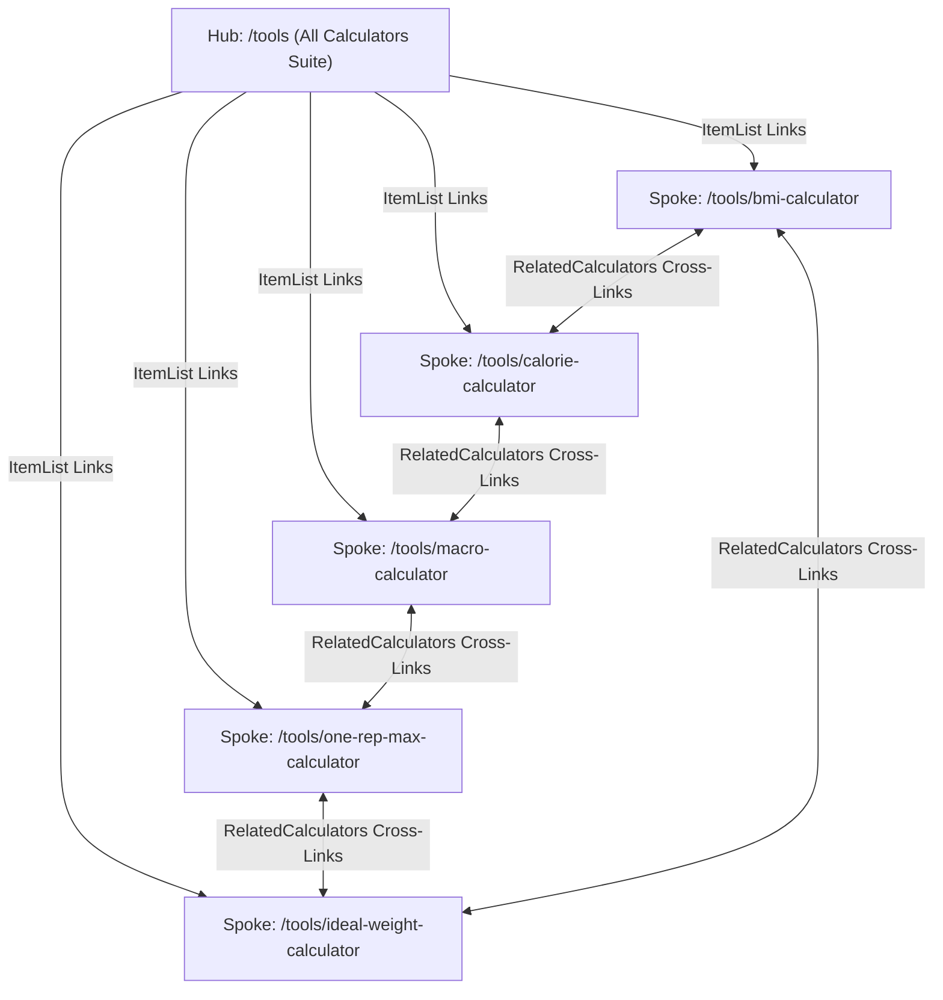

# Programmatic SEO (pSEO): Fitness Calculators Suite & Hub & Spoke Architecture

Документация по архитектуре интерактивных фитнес-калькуляторов FitWay, внедрению Programmatic SEO (pSEO) и переходу на модель Hub & Spoke для масштабирования органического поискового трафика без потери позиций основного хаба `/tools`.

---

## 🎯 Цели и предпосылки

1. **Захват высокоинтентного поискового трафика**: Пользователи, ищущие «macro calculator», «1rm calculator», «ideal weight calculator», обладают высокой готовностью к взаимодействию (транзакционный/исследовательский интент).
2. **Увеличение времени на сайте (Dwell Time) и вовлеченности**: Интерактивные формы удерживают пользователей на 2–4 минуты дольше стандартных статей, что является мощным позитивным поведенческим фактором для Google.
3. **Безопасное масштабирование без каннибализации (Hub & Spoke)**: Страница `/tools` уже была проиндексирована в Google Search Console и имела позиции. Создание изолированных страниц без связи могло бы размыть вес. Архитектура Hub & Spoke сохраняет хаб как авторитетный узел и распределяет внутренний вес на специализированные посадочные страницы.

---

## 🏗️ Архитектура Hub & Spoke

### 1. Центральный узел (Hub): `/tools`
- **Файл**: `frontend/src/app/tools/page.tsx`
- **Функция**: Каталог инструментов с быстрым превью основных калькуляторов (BMI, Calories), 4-шаговым описанием рабочего процесса («How to Use FitWay Tools for Optimal Results») и развернутым FAQ.
- **Сохранение существующих сигналов**:
  - Сохранены якорные ссылки `#bmi` и `#calories`, по которым пользователи и роботы уже могли переходить.
  - Сохранена микроразметка `SoftwareApplication` для каждого инструмента.
  - Внедрена схема `ItemList` со списком прямых ссылок на отдельные посадочные страницы.

### 2. Специализированные посадочные страницы (Spokes)

Каждая посадочная страница представляет собой исчерпывающий deep-dive гид с интерактивным калькулятором, научным обоснованием формул, практическими таблицами диапазонов и собственным FAQ-блоком.

| Страница | Маршрут | Интерактивный компонент | Научные формулы и стандарты |
| :--- | :--- | :--- | :--- |
| **BMI Calculator** | `/tools/bmi-calculator` | `BMICalculator.tsx` | Классификация ВОЗ (Underweight, Normal, Overweight, Obese I–III), метрическая и имперская формулы $BMI = \frac{\text{weight (kg)}}{\text{height (m)}^2}$. |
| **Daily Calorie & TDEE** | `/tools/calorie-calculator` | `CalorieCalculator.tsx` | Формула Миффлина — Сан-Жеора (Mifflin-St Jeor), коэффициенты физической активности PAL (1.2–1.9), расчет дефицита (-15%, -20%) и профицита (+10%). |
| **Macro Splitter (P/F/C)** | `/tools/macro-calculator` | `MacroCalculator.tsx` | Стандарты ISSN (International Society of Sports Nutrition): 1.6–2.2 г белка на кг веса тела, процентные и граммовые сплиты для похудения, поддержания и набора массы, разбивка по приемам пищи. |
| **One-Rep Max (1RM)** | `/tools/one-rep-max-calculator` | `OneRepMaxCalculator.tsx` | Формулы Эпли (Epley: $w \cdot (1 + r/30)$) и Бжицки (Brzycki: $w \cdot \frac{36}{37 - r}$), тренировочные зоны от 95% до 50% (Power, Strength, Hypertrophy, Endurance) и таблица расчетных повторов от 1 до 12. |
| **Ideal Body Weight (IBW)** | `/tools/ideal-weight-calculator` | `IdealWeightCalculator.tsx` | Клиническое сопоставление 4 формул: Devine (1974), Robinson (1983), Miller (1983), Hamwi (1964) и здоровый диапазон по нормам ВОЗ (BMI 18.5–24.9). |

---

## 💻 Интерактивные компоненты

### 1. `MacroCalculator.tsx`
- **Путь**: `frontend/src/components/calculators/MacroCalculator.tsx`
- **Возможности**:
  - Выбор цели: `Fat Loss` (высокий белок 2.2 г/кг, умеренные жиры, низкие углеводы), `Maintenance` (сбалансированный сплит 30/30/40), `Muscle Gain` (высокоуглеводный профицит 25/20/55).
  - Поддержка метрической и имперской систем с мгновенной конвертацией.
  - Интерактивный визуальный прогресс-бар макронутриентов с акцентными цветами (Белки — синий, Жиры — янтарный, Углеводы — изумрудный).
  - Калькулятор разбивки по приемам пищи (от 3 до 6 приемов в день).

### 2. `OneRepMaxCalculator.tsx`
- **Путь**: `frontend/src/components/calculators/OneRepMaxCalculator.tsx`
- **Возможности**:
  - Быстрый выбор ключевых базовых движений: Barbell Squat, Bench Press, Deadlift, Overhead Press.
  - Одновременный расчет по формуле Epley и Brzycki с выводом усредненного максимального сингла.
  - Таблица процентных рабочих зон (95%, 90%, 85%, 80%, 75%, 70%, 65%, 60%, 50%) с целевым количеством повторений и тренировочной направленностью (Max Strength, Strength-Power, Hypertrophy, Muscular Endurance).
  - Сетка прогнозируемых весов от 1 до 12 повторений.

### 3. `IdealWeightCalculator.tsx`
- **Путь**: `frontend/src/components/calculators/IdealWeightCalculator.tsx`
- **Возможности**:
  - Выбор пола (мужской/женский) и системы единиц (см/кг vs ft/in/lbs).
  - Сводный индикатор среднего идеального веса и сравнение с текущим весом пользователя (дефицит/профицит).
  - Сравнительная таблица клинических формул (Devine, Robinson, Miller, Hamwi) с указанием года разработки и сферы применения.
  - Здоровый диапазон веса по стандартам Всемирной организации здравоохранения (ВОЗ).

### 4. `RelatedCalculators.tsx`
- **Путь**: `frontend/src/components/calculators/RelatedCalculators.tsx`
- **Назначение**: Компонент перелинковки, монтируемый внизу каждой из 5 посадочных страниц.
- **Логика**: Фильтрует текущую страницу (`filter(tool => tool.id !== currentTool)`) и выводит сетку из 4 остальных калькуляторов с иконками, тегами категорий и кратким описанием, замыкая внутренний кольцевой ссылочный граф.

---

## 🔍 SEO & Структурированные данные (Schema.org)

Каждая страница оснащена валидным графом структурированных данных в формате JSON-LD:

1. **`SoftwareApplication`**:
   - `applicationCategory`: `HealthApplication` / `SportsApplication`
   - `operatingSystem`: `All`
   - `offers`: `{ @type: "Offer", price: "0", priceCurrency: "USD" }`
   - `featureList`: Список функциональных возможностей калькулятора.
2. **`FAQPage`**:
   - Включает 4–5 глубоких вопросов-ответов с разметкой `mainEntity` (`Question` + `AcceptedAnswer`). Позволяет поисковым системам генерировать расширенные сниппеты (Rich Snippets).
3. **Самореферентный Canonical Tag**:
   - Каждая страница явно указывает `alternates: { canonical: "https://fitway.best/tools/[slug]" }` во избежание наследования дефолтного тега из `layout.tsx`.

---

## ⚠️ Критические особенности и Gotchas

### 1. Предотвращение дублирования Breadcrumbs
- **Проблема**: При добавлении страниц инструментов на экран выводились две полосы хлебных крошек (одна сверху, вторая чуть ниже).
- **Причина**: В `frontend/src/app/layout.tsx` компонент `<Breadcrumbs />` уже подключен глобально в контейнере `<main className="flex-grow relative">` с абсолютным позиционированием.
- **Правило**: На посадочных страницах калькуляторов **запрещено** повторно вызывать `<Breadcrumbs />`. Верхний отступ секции задается через `pt-12` или `pt-16` в контейнере, чтобы контент не перекрывался глобальной полосой крошек. Подробнее: [[frontend/breadcrumbs]].

### 2. Синхронизация карт сайта и краулеров
Все 5 новых URL обязательно зарегистрированы в 3 источниках:
1. **XML Sitemap (`frontend/src/app/sitemap.ts`)**: добавлены в массив `staticPages` со статусом `weekly` и приоритетом `0.8`.
2. **HTML Sitemap (`frontend/src/app/sitemap/page.tsx`)**: вынесены в отдельный раздел «Fitness Calculators Suite» с якорным переходом `#fitness-calculators`. Подробнее: [[frontend/html-sitemap]].
3. **Agentic Web (`frontend/public/llms.txt`)**: добавлены прямые markdown-ссылки с описанием для поисковых AI-агентов (Perplexity, ChatGPT Search, Gemini). Подробнее: [[frontend/agentic-web-llms-txt]].

---

## 🔗 Связанные документы базы знаний

- [[frontend/seo]] — Общая SEO-стратегия, микроразметка Schema.org и борьба с Thin Content.
- [[roadmap/adsense-approval-plan]] — Дорожная карта прохождения модерации Google AdSense.
- [[frontend/navigation-mega-menu]] — Двухуровневое выпадающее меню навигации (Desktop Mega-Menu & Mobile Accordion).
- [[frontend/breadcrumbs]] — Глобальная архитектура компонента хлебных крошек.
- [[frontend/html-sitemap]] — Премиальная HTML-карта сайта `/sitemap`.
- [[frontend/agentic-web-llms-txt]] — Индексация для автономных AI-краулеров.

