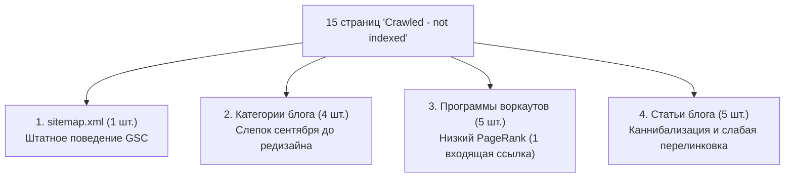

# Resolving "Crawled - Currently Not Indexed" in Google Search Console: Internal Linking & Anti-Cannibalization Strategy

Документация по глубокой диагностике и устранению статуса Google Search Console **«Проскановано – наразі не проіндексовано» (Crawled - currently not indexed)** для 15 страниц FitWay, ликвидации каннибализации поисковых запросов и развертыванию кольцевой внутренней перелинковки.

---

## 🎯 Диагностика инцидента (2026-11-09)

В Google Search Console зафиксировано 15 страниц в статусе «Просканировано, но не проиндексировано». Через [[frontend/gsc-api-integration]] и метод `urlInspection.index.inspect` была проведена проверка URL.

### Результаты анализа ответа Googlebot:
- `robotsTxtState: ALLOWED` (Robots.txt не блокирует робота, рендеринг JS/CSS успешен).
- `indexingState: INDEXING_ALLOWED` (Тег `noindex` отсутствует, директива индексации открыта).
- `pageFetchState: SUCCESSFUL` (Страницы отдают HTTP 200 OK без ошибок сервера).
- `googleCanonical == userCanonical` (Канонические теги самореферентны и согласованы).

**Ключевой вывод**: Технических препятствий нет. Причина невключения в индекс — **алгоритмическая оценка ценности и качества (Helpful Content / Crawl Priority)** на момент первичного обхода страниц в сентябре 2026 года.

---

## 🔍 Анализ 4 групп непроиндексированных страниц

### 1. `https://fitway.best/sitemap.xml`
- **Дата обхода**: 27 октября 2026 г.
- **Причина**: Файл карты сайта является служебным XML-фидом данных для поисковых ботов. Google скачивает его для извлечения ссылок, но никогда не индексирует XML-файлы в органической выдаче для пользователей.
- **Решение**: Штатное поведение. Действий не требуется.

### 2. Категории блога (`/blog/category/*`)
- **URL**: `category/nutrition` (24 сен), `category/weight-loss` (21 сен), `category/muscle-building` (20 сен), `category/motivation` (19 сен).
- **Причина**: В конце сентября страницы категорий представляли собой голые списки карточек статей без единого абзаца уникального текста («Thin Content») и имели старый баг наследования каноникала [[bugs/canonical-tag-inheritance]]. Googlebot просканировал их в том состоянии и с тех пор не возвращался.
- **Решение**: Наполнение категорий глубоким SEO-контентом через [[frontend/ai-agents-skills-architecture]] (навык `fitway-category-seo`).

### 3. Программы тренировок (`/workouts/*`)
- **URL**: `beginner-functional-hiit...`, `intermediate-legs-hiit...`, `intermediate-bodyweight-toning...`, `beginner-bodyweight-workout...`, `advanced-upper-body-hiit...`.
- **Причина**: В отчете API зафиксировано `referringUrls: ["https://fitway.best/"]`. У страниц была всего одна входящая ссылка со сквозной навигации. Для молодого домена с ограниченным Crawl Budget страницы без глубокой перелинковки откладываются роботом.
- **Решение**: Внедрение прямых контекстных ссылок на эти воркауты из текстов обновленных категорий блога (`Training`, `Motivation`).

### 4. Статьи блога
- **URL**:
  - `blog/progressive-overload-training-principle-muscle-growth` (12 сен)
  - `blog/what-eat-after-workout-faster-muscle-recovery` (24 окт)
  - `blog/lose-weight-without-losing-muscle` (8 сен)
  - `blog/build-consistent-workout-habit-that-sticks` (1 сен)
- **Причина**:
  1. *Каннибализация*: Одновременное наличие двух общих статей про прогрессивную перегрузку (`progressive-overload-consistent-muscle-growth` и `progressive-overload-training-principle-muscle-growth`). Google выбрал первую, а вторую отсеял как смысловой дубликат.
  2. *Слабая перелинковка*: Статья про питание после тренировки имела всего 1 входящую внутреннюю ссылку (со статьи про pre-workout) и не имела FAQ.

---

## 🛠️ Реализованная стратегия устранения проблемы

### 1. Ликвидация каннибализации (Dumbbell Progressive Overload Focus)
Статья со slug `progressive-overload-training-principle-muscle-growth` полностью переориентирована с общей теории на **прикладное руководство по прогрессивной перегрузке с гантелями**:
- **Новый Title**: *«Progressive Overload with Dumbbells: How to Build Muscle with Limited Weights»*.
- **Уникальная ценность**: Решение проблемы «потолка гантелей» (шаг в 2–2.5 кг) через 5 переменных без увеличения веса (Double Progression Method, темп 3-1-1, диапазон движения, плотность отдыха, углы наклона).
- **Научный фундамент (PubMed)**:
  - `PMID: 36199287`: Chaves et al. (2022) *«Progressive overload without progressing load»*.
  - `PMID: 33671664`: Schoenfeld et al. (2021) *«Loading recommendations: Re-examination of the repetition continuum»*.
  - `PMID: 28834797`: Schoenfeld et al. (2017) *«Low-load vs. high-load resistance training meta-analysis»*.
- **Перелинковка**: В статью встроена прямая ссылка на базовый теоретический материал [Progressive Overload: The Ultimate Guide to Consistent Muscle Growth](/blog/progressive-overload-consistent-muscle-growth), что устраняет конфликт и превращает вторую статью в логический Spoke первого материала.

### 2. Усиление через статью-лидер по трафику (`hypertrophy-training-guide...`)
Статья [`hypertrophy-training-guide-building-muscle-size`](https://fitway.best/blog/hypertrophy-training-guide-building-muscle-size) имеет наибольшее число показов и кликов в GSC. В раздел `## Nutrition to Support Hypertrophy` внедрены две прямые ссылки на застрявшие статьи:
1. `[what to eat after a workout for faster recovery](/blog/what-eat-after-workout-faster-muscle-recovery)`
2. `[how to lose weight without losing muscle](/blog/lose-weight-without-losing-muscle)`
3. Ссылка на калькулятор `[FitWay Macro Splitter Calculator](/tools/macro-calculator)`.
*Результат*: Робот при регулярном обходе лидера трафика мгновенно переходит по ссылкам и индексирует целевые статьи.

### 3. Доработка контента `what-eat-after-workout-faster-muscle-recovery`
- Добавлен блок `## Frequently Asked Questions` (3 вопроса) для снятия подозрения в "Thin Content".
- Добавлена контекстная ссылка на калькулятор макросов [FitWay Macro Splitter](/tools/macro-calculator).
- Получена дополнительная ссылка из хаба категории [Nutrition](/blog/category/nutrition).

### 4. Наполнение страниц категорий (Хабы)
С помощью навыка [[frontend/ai-agents-skills-architecture]] созданы и внедрены в Strapi полные SEO-описания категорий:
- **Nutrition**: Связана с калькуляторами калорий и БЖУ, статьями о питании.
- **Muscle Building**: Связана с калькулятором 1RM и статьями о гипертрофии.
- **Training**: Передает PageRank на непроиндексированные воркауты `beginner-bodyweight...` и `intermediate-bodyweight...`.
- **Motivation**: Передает PageRank на `build-consistent-workout-habit...` и воркаут `beginner-functional-hiit...`.

---

## 📋 Протокол отправки на переиндексацию (GSC Action Checklist)

После сохранения контента в Strapi Admin:
1. Открыть панель Google Search Console.
2. Ввести в верхнюю строку проверки URL:
   - `https://fitway.best/blog/progressive-overload-training-principle-muscle-growth`
   - `https://fitway.best/blog/what-eat-after-workout-faster-muscle-recovery`
   - `https://fitway.best/blog/lose-weight-without-losing-muscle`
   - `https://fitway.best/blog/category/nutrition`
3. Нажать кнопку **«Запросити індексування» (Request Indexing)**.

---

## 🔗 Связанные документы
- [[frontend/gsc-api-integration]] — API-клиент Search Console и URL Inspection инструмент.
- [[frontend/blog-category-content-system]] — Архитектура H1, intro и Markdown-текста категорий блога.
- [[frontend/fitness-calculators-pseo]] — Архитектура калькуляторов и Hub & Spoke модель.
- [[frontend/seo]] — Главная SEO-стратегия и правила перелинковки.
- [[roadmap/adsense-approval-plan]] — Дорожная карта снятия статуса «Бесполезный контент».
