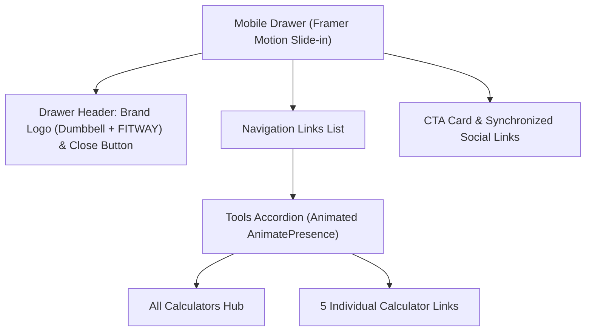

# Two-Level Navigation Menu (Mega-Dropdown & Mobile Accordion)

Документация по реализации двухуровневой системы навигации FitWay: премиального десктопного мега-дропдауна (`Navbar.tsx`) и мобильного анимированного аккордеона (`MobileMenu.tsx`).

---

## 🎯 Назначение и контекст

С появлением 5 отдельных посадочных страниц интерактивных калькуляторов возникла необходимость предоставить пользователю мгновенный доступ ко всей линейке инструментов из главного меню без необходимости лишних переходов через промежуточный каталог.

Новое меню решает следующие задачи:
1. **Информационная прозрачность**: пользователь сразу видит доступные инструменты с описанием их назначения.
2. **Внутренняя перелинковка (PageRank Distribution)**: сквозные ссылки из главного меню передают максимальный статический вес на посадочные страницы калькуляторов.
3. **Премиальный UX/UI**: сохранение фирменной тёмной эстетики FitWay (`#1B2B3B`, акцент `#FF8C00`, glassmorphism, неоновый glow).

---

## 🖥️ Десктопный мега-дропдаун (`Navbar.tsx`)

- **Файл**: `frontend/src/components/Navbar.tsx`

### 1. Механика взаимодействия (Hover & Click)
- **Защита от случайного закрытия (Debounced Leave)**: При уводе курсора с триггера закрытие происходит с задержкой 150 мс (`setTimeout`). Это предотвращает дергание и случайное схлопывание меню при движении мыши в выпадающее окно.
- **Двойной контроль**: Поддерживается как наведение курсора (`onMouseEnter`/`onMouseLeave`), так и клик по шеврону со стандартными атрибутами доступности (`aria-expanded`, `aria-haspopup="true"`).
- **Слушатели закрытия**: Меню автоматически закрывается при клике вне области (`useRef` + `mousedown`) и при смене маршрута (`usePathname`).

### 2. Геометрия и позиционирование
- **Выравнивание по левому краю ссылки (`left-0`)**: Выпадающий контейнер строго выровнен по вертикальной оси ссылки "Tools", создавая чистую визуальную линию.
- **Ширина**: `w-[460px]`, что обеспечивает достаточное пространство для отображения заголовков, описаний и бейджей категорий в одну строку без переносов.
- **Центрированный верхний неоновый акцент**:
  ```tsx
  <div className="absolute -top-px left-1/2 -translate-x-1/2 w-40 h-0.5 bg-gradient-to-r from-transparent via-[#FF8C00] to-transparent shadow-[0_0_12px_#FF8C00]" />
  ```

### 3. Решение конфликта Framer Motion и Tailwind Transform
> [!WARNING] Framer Motion Transform Conflict
> При использовании `<motion.div>` с анимациями появления (`initial={{ opacity: 0, y: 10 }} animate={{ opacity: 1, y: 0 }}`) библиотека генерирует инлайн-стиль `style="transform: translateY(0px)..."`.  
> Этот инлайн-стиль полностью затирает CSS-свойства Tailwind типа `-translate-x-1/2`, сдвигая блок вправо.
> 
> **Решение**: Позиционировать анимированный контейнер строго через CSS-свойства `left-0 top-full pt-3` без использования Tailwind `transform` на самом элементе `<motion.div>`. Любые элементы с центрированием через `transform: -translate-x-1/2` (например, верхняя линия свечения) должны быть обычными `<div>` внутри контейнера.

### 4. Пиксель-перфектная визуальная сетка (Visual Rhythm)
Для всех 6 элементов меню (верхний баннер-хаб + 5 калькуляторов) установлена единая метрическая сетка:
- Внутренние отступы контейнера: `p-2.5`
- Расстояние между иконкой и текстом: `gap-3`
- Контейнер иконки: `w-9 h-9 rounded-xl` с центрированием `flex items-center justify-center shrink-0`
- Размер внутренней иконки: `w-4 h-4`
- Бейджи категорий: `px-2 py-0.5 text-[10px] uppercase font-semibold rounded-md border border-white/10`

---

## 📱 Мобильный аккордеон навигации (`MobileMenu.tsx`)

- **Файл**: `frontend/src/components/MobileMenu.tsx`



### 1. Логотип бренда в шапке открытого дровера
При открытии мобильного меню на весь экран пользователь терял контекст шапки сайта. В верхний бар дровера добавлен фирменный логотип FitWay:
- Оранжевая иконка гантели (`Dumbbell` в `#FF8C00`).
- Текстовый логотип `FITWAY` со стилизацией `text-xl font-black tracking-wider text-white`.
- Клик по логотипу ведет на главную (`/`) и автоматически закрывает меню.

### 2. Анимированный вложенный аккордеон
- Кнопка «Tools» оснащена анимированным шевроном (`ChevronDown`), плавно вращающимся на 180° (`rotate-180`) при открытии.
- Раскрытие списка выполнено через `framer-motion` (`initial={{ opacity: 0, height: 0 }}`, `animate={{ opacity: 1, height: "auto" }}`).
- Вложенные элементы содержат цветные иконки, теги направлений (`HUB`, `HEALTH`, `METABOLISM`, `NUTRITION`, `STRENGTH`, `BASELINE`) и приятные hover/tap состояния.

### 3. Синхронизация социальных сетей с десктопным футером
В блоке ссылок соцсетей мобильного меню устаревшие ссылки заменены на официальные подтвержденные аккаунты FitWay:
- **Facebook**: `https://www.facebook.com/fitway.best/`
- **Instagram**: `https://www.instagram.com/fitway.best/`
- **Twitter / X**: `https://x.com/fitway_best`
- Атрибуты ссылок: `target="_blank"` и `rel="noopener noreferrer"`.

---

## 🔗 Связанные документы базы знаний

- [[frontend/mobile-menu]] — Базовая архитектура мобильного меню и предотвращение сдвига верстки (Scroll Lock).
- [[frontend/fitness-calculators-pseo]] — Архитектура посадочных страниц калькуляторов и Programmatic SEO.
- [[frontend/responsive-layout]] — Адаптивные сетки и брейкпоинты FitWay.
- [[frontend/trust-signals-contacts]] — Сигналы доверия, контакты и официальные профили бренда.
- [[bugs/framer-motion-animation-flicker]] — Анализ конфликтов между анимациями Framer Motion и классами Tailwind CSS.

