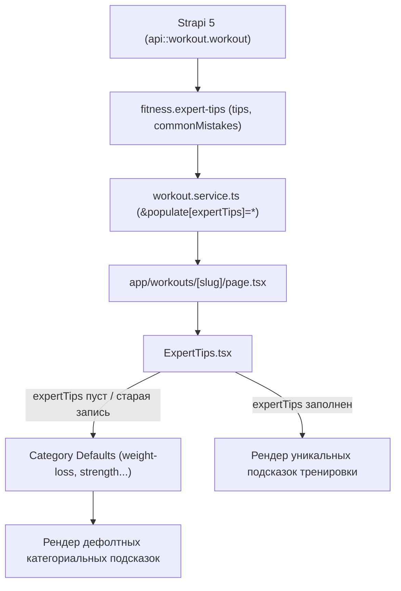

# Workout Expert Tips & Common Mistakes Architecture

Архитектура системы тренерских макро-подсказок (`Expert Tips`) и типичных ошибок (`Common Mistakes`) на детальных страницах тренировок FitWay (`/workouts/[slug]`).

---

## 🎯 Контекст и проблематика

Ранее компонент [`frontend/src/components/workouts/ExpertTips.tsx`](file:///d:/Users/doomi/ReactProjects/FitWay/frontend/src/components/workouts/ExpertTips.tsx) содержал захардкоженный статический словарь для 5 категорий тренировок (`weight-loss`, `muscle-gain`, `toning`, `flexibility`, `strength`). 

### Проблемы старого подхода:
1. **Дублированный контент (SEO / AdSense Risk)**: Все 30+ воркаутов в категории `weight-loss` содержали абсолютно идентичные 6 предложений. Алгоритмы Google и модераторы Google AdSense расценивают повторяющийся шаблонный текст как «Низкокачественный / Бесполезный контент» (*Low Value / Thin Content*).
2. **Потеря контекста (UX)**: Общий совет *«Progressive overload is key»* не давал никакой специфичной пользы атлету, выполняющему конкретный протокол (например, 40-минутный плиометрический HIIT на ноги или тренировку спины со становой тягой).
3. **Рассинхрон с микро-подсказками упражнений**: В карточках [`ExerciseCard.tsx`](file:///d:/Users/doomi/ReactProjects/FitWay/frontend/src/components/workouts/ExerciseCard.tsx) уже выводились микро-советы для каждого движения (`tips` и `commonMistakes`). Блок на уровне тренировки должен закрывать **макро-стратегию всей тренировочной сессии** (темп, дыхательный паттерн, распределение сил, профилактика травм протокола).

---

## 🏗️ Архитектурное решение: Гибридная модель

Выбрана гибридная модель: **Workout-level хранение в Strapi 5 с гарантированным Category-level Fallback в Next.js 14**.



### Преимущества:
- **100% уникальность страниц**: Каждая новая тренировка получает свои персональные подсказки.
- **Нулевой риск регрессии**: Старые тренировки в базе без заполненного компонента не ломаются и не оставляют пустые блоки — срабатывает элегантный fallback на проверенные базовые подсказки категории.
- **Автоматизация через AI Skill**: Контент-менеджеру не нужно писать тексты вручную — навык [`fitway-workout-generator`](file:///d:/Users/doomi/ReactProjects/FitWay/.agents/skills/fitway-workout-generator/SKILL.md) генерирует их в едином JSON при создании программы.

---

## 🛠️ 1. Бэкенд (Strapi v5)

### Компонент `fitness.expert-tips`
Создан компонент [`backend/src/components/fitness/expert-tips.json`](file:///d:/Users/doomi/ReactProjects/FitWay/backend/src/components/fitness/expert-tips.json):
```json
{
  "collectionName": "components_fitness_expert_tips",
  "info": {
    "displayName": "Expert Tips",
    "icon": "lightbulb",
    "description": "Expert coaching tips and common mistakes for the workout"
  },
  "options": {},
  "attributes": {
    "tips": {
      "type": "text",
      "required": false
    },
    "commonMistakes": {
      "type": "text",
      "required": false
    }
  }
}
```

### Схема коллекции `Workout`
В [`backend/src/api/workout/content-types/workout/schema.json`](file:///d:/Users/doomi/ReactProjects/FitWay/backend/src/api/workout/content-types/workout/schema.json) подключен нерекурсивный компонент `expertTips`:
```json
"expertTips": {
  "type": "component",
  "repeatable": false,
  "component": "fitness.expert-tips"
}
```

---

## 💻 2. Фронтенд (Next.js 14 App Router)

### Интерфейс TypeScript
В [`frontend/src/interfaces/workout.ts`](file:///d:/Users/doomi/ReactProjects/FitWay/frontend/src/interfaces/workout.ts):
```typescript
export interface Workout {
  // ...
  nutritionAdvice?: {
    preWorkout?: string;
    postWorkout?: string;
    hydration?: string;
  };
  expertTips?: {
    tips?: string | string[];
    commonMistakes?: string | string[];
  };
  // ...
}
```

### Сервисный слой (Service Layer Pattern)
В [`frontend/src/services/workout.service.ts`](file:///d:/Users/doomi/ReactProjects/FitWay/frontend/src/services/workout.service.ts) запрос `getWorkoutBySlug` дополнен явным `populate` для компонентов:
```typescript
populate[nutritionAdvice]=*&populate[expertTips]=*
```

### Компонент `ExpertTips.tsx` с регулярным парсером
В [`frontend/src/components/workouts/ExpertTips.tsx`](file:///d:/Users/doomi/ReactProjects/FitWay/frontend/src/components/workouts/ExpertTips.tsx) встроен устойчивый парсер `parseTipsList`:
```typescript
function parseTipsList(input?: string | string[]): string[] {
  if (!input) return [];
  if (Array.isArray(input)) {
    return input.map((item) => (typeof item === "string" ? item.trim() : String(item))).filter(Boolean);
  }
  if (typeof input === "string") {
    return input
      .split(/\r?\n/)
      .map((line) => line.trim())
      .map((line) => line.replace(/^([*•\-–—]|\d+[\.\)])\s*/, "").trim())
      .filter((line) => line.length > 0);
  }
  return [];
}
```
Парсер безопасно очищает маркеры списков (`-`, `*`, `•`, `1.`), поддерживает как многострочные строки из Strapi textarea, так и массивы JSON.

---

## 🤖 3. Синхронизация AI-навыка и скриптов импорта

### Навык `fitway-workout-generator`
Обновлены:
- [`.agents/skills/fitway-workout-generator/SKILL.md`](file:///d:/Users/doomi/ReactProjects/FitWay/.agents/skills/fitway-workout-generator/SKILL.md) — добавлено правило генерации макро-стратегии сессии и чеклист валидации.
- [`references/json-schema.md`](file:///d:/Users/doomi/ReactProjects/FitWay/.agents/skills/fitway-workout-generator/references/json-schema.md) — зафиксирована спецификация поля `expertTips`.
- [`references/ui-structure.md`](file:///d:/Users/doomi/ReactProjects/FitWay/.agents/skills/fitway-workout-generator/references/ui-structure.md) — актуализирована карта интерфейса страницы воркаута.

### Скрипты импорта (`push-workout.js` & `import-workouts.js`)
В оба загрузчика добавлен санитайзер внутренних Strapi ID:
```javascript
...(expertTips
  ? {
      expertTips: (({ id: _id, ...comp }) => comp)(expertTips),
    }
  : {})
```

### Файл данных `backend/scripts/workouts.json`
Файл приведен в соответствие:
- Добавлен блок `expertTips` с уникальными рекомендациями для *Intermediate Legs HIIT*.
- Добавлены связи E-E-A-T (`author: { id: 1 }`, `reviewedBy: [{ id: 5 }]`).
- Добавлена контекстная ссылка на калькулятор калорий (`/tools/calorie-calculator`).

---

## 🛡️ 4. Исключение Python-кэша (`__pycache__`)

В корневой [`.gitignore`](file:///d:/Users/doomi/ReactProjects/FitWay/.gitignore) добавлены правила игнорирования скомпилированного байткода Python:
```gitignore
# Python
__pycache__/
*.py[cod]
*$py.class
```
Это предотвращает случайную фиксацию временных артефактов верификационных Python-скриптов в корне проекта.

---

## 🔗 Связанные разделы базы знаний
- [[frontend/workouts-ui]] — Архитектура каталога и карточек тренировок `WorkoutCard`.
- [[frontend/ai-agents-skills-architecture]] — Спецификация агента `seo-adsense-architect` и навыков контента.
- [[backend/strapi-content-types]] — Контент-типы и компоненты Strapi v5.
- [[backend/strapi-v5-collections]] — Регламент создания коллекций и разрешений API-токенов в Strapi.
- [[frontend/data-fetching-pattern]] — Service Layer паттерн в Next.js 14 App Router.
- [[frontend/seo]] — Стратегия преодоления Thin Content и AdSense Low Value Content.
- [[roadmap/adsense-approval-plan]] — Дорожная карта получения одобрения Google AdSense.

